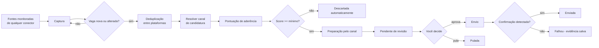

# 01 — Visão geral

## Objetivo

Reduzir o tempo gasto procurando e se candidatando a vagas, **sem perder a qualidade das candidaturas**. O robô faz o trabalho repetitivo (varrer fontes de vagas, filtrar, preencher formulários) e você decide o que é enviado.

As plataformas entram como **conectores plugáveis**. A primeira é o **InHire**; LinkedIn, Gupy, Greenhouse, Lever e outras podem ser adicionadas depois sem mudar o núcleo (ver `docs/02-arquitetura.md` e `docs/07-conectores.md`).

## Primeiro conector: como o InHire funciona (premissas)

- O InHire é um ATS (sistema de recrutamento) usado pelas empresas. Cada empresa publica vagas em seu subdomínio: `https://{slug}.inhire.app/vagas`.
- **Não há agregador central** conhecido com todas as vagas do InHire. A aplicação precisa manter uma lista de empresas (slugs) monitoradas.
- As páginas são aplicações JavaScript (SPA): o HTML inicial não contém as vagas. Elas são carregadas depois, provavelmente via chamadas XHR/fetch a uma API interna.
- O formulário de candidatura tem campos padrão (nome, e-mail, telefone, currículo, LinkedIn) e **perguntas de triagem** variáveis por vaga. Essas perguntas podem eliminar o candidato automaticamente, então respostas genéricas são um risco real.

Essas premissas precisam ser confirmadas na etapa de reconhecimento (`docs/07.1-conector-inhire.md`).

## Escopo

### Dentro
- Arquitetura de conectores genérica: contratos por capacidade, registro por chave, kit de testes de contrato.
- Conector InHire (captura + canal de candidatura).
- Cadastro de **fontes monitoradas** (por conector): páginas de carreira de empresas (tenants) ou buscas salvas.
- Varredura periódica das fontes, com upsert, detecção de vagas encerradas e deduplicação entre plataformas.
- Perfis de busca (palavras-chave incluídas/excluídas, local, modelo de trabalho, senioridade) e pontuação de aderência.
- Preparação de candidatura: abrir o formulário, extrair campos e perguntas, propor respostas a partir de um banco de respostas reutilizáveis.
- API local de revisão: listar candidaturas pendentes, editar respostas, aprovar ou pular.
- Envio após aprovação, com limite diário, delays de cortesia, evidência (screenshot) e verificação de confirmação.
- Histórico completo e idempotência (nunca se candidatar duas vezes à mesma vaga).

### Fora (por enquanto)
- Conectores além do InHire. A arquitetura já os suporta; cada um terá sua própria spec.
- Interface web própria (a revisão usa a UI do Scalar; uma UI dedicada é evolução futura).
- Envio 100% automático sem revisão.
- Resolução de captchas ou contorno de qualquer proteção da plataforma.
- Hospedagem em nuvem (roda localmente na sua máquina).

## Fluxo ponta a ponta

## Modos de operação

| Modo | Descrição | Padrão |
|---|---|---|
| **Revisão via API** | O robô prepara, você aprova pela API/Scalar, o robô envia em segundo plano (headless). | **Sim** |
| **Assistido no navegador** | O robô abre um navegador visível com o formulário preenchido e você mesmo clica em enviar. Útil para vagas com perguntas complexas ou upload extra. | Opcional |
| Automático | Envio sem revisão. | **Não implementar** (ver ADR-004) |

## Riscos e mitigação

| Risco | Impacto | Mitigação |
|---|---|---|
| Termos de uso de uma plataforma proibirem automação | Bloqueio de conta, descarte de candidaturas | Matriz de conectores registra o que cada plataforma permite; baixo volume; delays de cortesia; revisão humana; nunca contornar proteções |
| Layout de uma plataforma mudar | Conector quebra | Seletores centralizados por conector, fixtures, evidência salva, `ConnectorError.LayoutChanged`; os demais conectores continuam funcionando |
| Mesma vaga em duas plataformas | Candidatura duplicada | Deduplicação por URL de candidatura e fingerprint; `Application` única por vaga canônica |
| Perguntas de triagem respondidas errado | Eliminação automática | Revisão obrigatória; banco de respostas curado por você; sugestões de LLM sempre revisadas |
| Candidaturas em massa percebidas pelo recrutador | Má impressão | Perfis de busca restritivos, score mínimo, limite diário |
| Vazamento de dados pessoais | Exposição de PII | Dados só locais, user-secrets, logs sem PII, `Artifacts/` fora do git |
| Captcha / login inesperado | Envio interrompido | Parar, marcar `RequiresManualAction`, notificar, usar modo assistido |

## Dados pessoais (LGPD)

Os únicos dados pessoais tratados são **os seus**, como candidato, e os dados públicos das vagas. Ainda assim:

- Armazenamento somente local (PostgreSQL no Docker da sua máquina).
- Segredos e dados de contato via `dotnet user-secrets`, não em arquivos versionados.
- Envio para LLM (opcional) restrito a texto da pergunta, descrição da vaga e resumo profissional.
- Retenção configurável de evidências.

## Glossário

| Termo | Significado |
|---|---|
| **Connector** | Adaptador de uma plataforma (InHire, LinkedIn...), identificado por uma chave (`inhire`) |
| **Capability** | O que um conector sabe fazer: listar por tenant, buscar, detalhar, candidatar, descobrir tenants |
| **Tenant** | Página de carreira de uma empresa dentro de uma plataforma (no InHire, o `slug` do subdomínio) |
| **SourceTarget** | Algo monitorado: um tenant ou uma busca salva, de um conector |
| **PostingSource** | Registro de onde uma vaga foi vista (conector + id externo) |
| **Apply channel** | Conector que envia a candidatura de uma vaga; pode ser diferente do conector de captura |
| **Company** | Empresa real, independente de plataforma |
| **JobPosting** | Vaga canônica (deduplicada), com uma ou mais `PostingSource` |
| **SearchProfile** | Critérios de busca e pesos de pontuação |
| **Match score** | Nota de 0 a 100 de aderência da vaga ao perfil |
| **Application** | Candidatura a uma vaga, com ciclo de vida próprio |
| **ApplicationQuestion** | Campo/pergunta do formulário da vaga com resposta proposta e final |
| **AnswerTemplate** | Resposta reutilizável para perguntas recorrentes |
| **ScanRun** | Execução de uma varredura, com métricas e erros |
| **Artifact** | Evidência gravada em disco (screenshot, HTML) |
