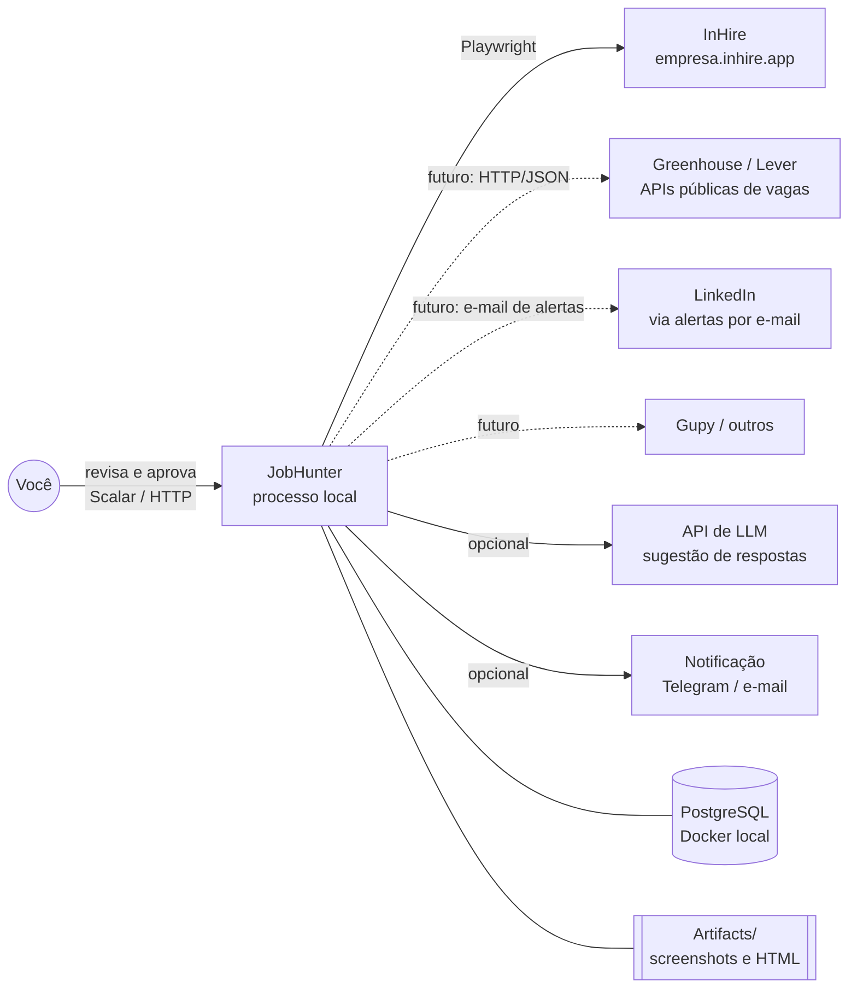
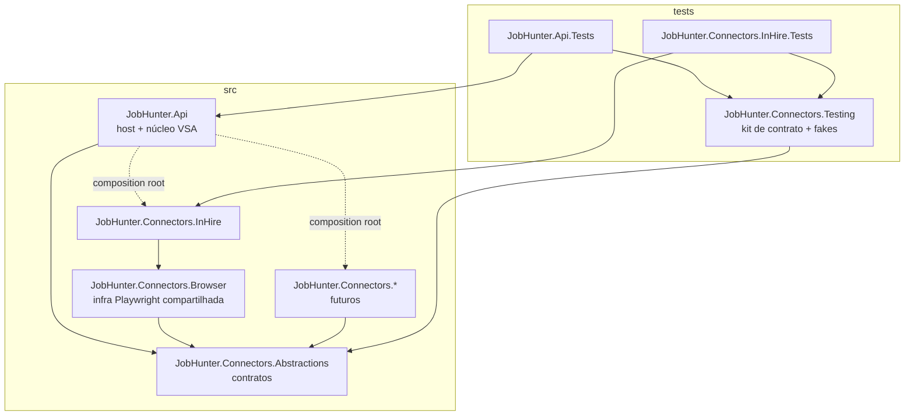
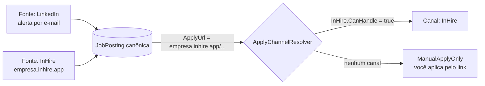
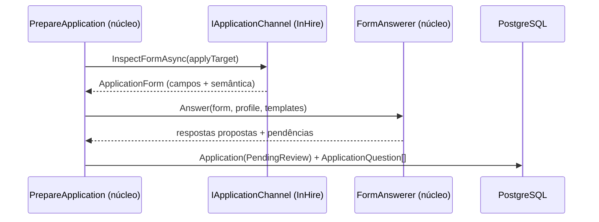
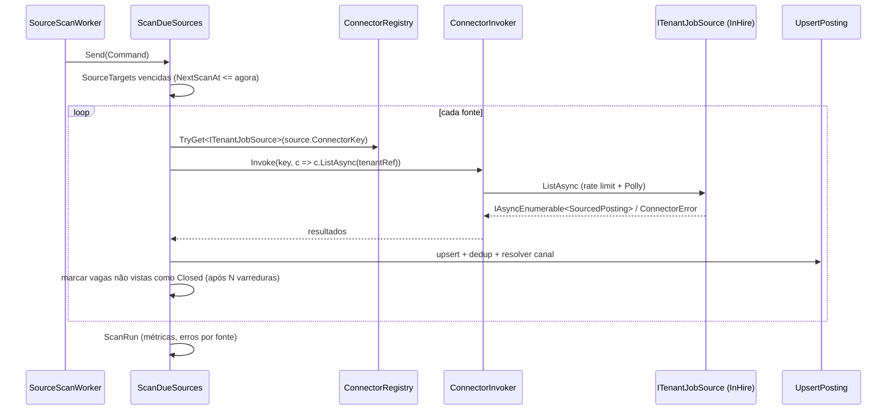
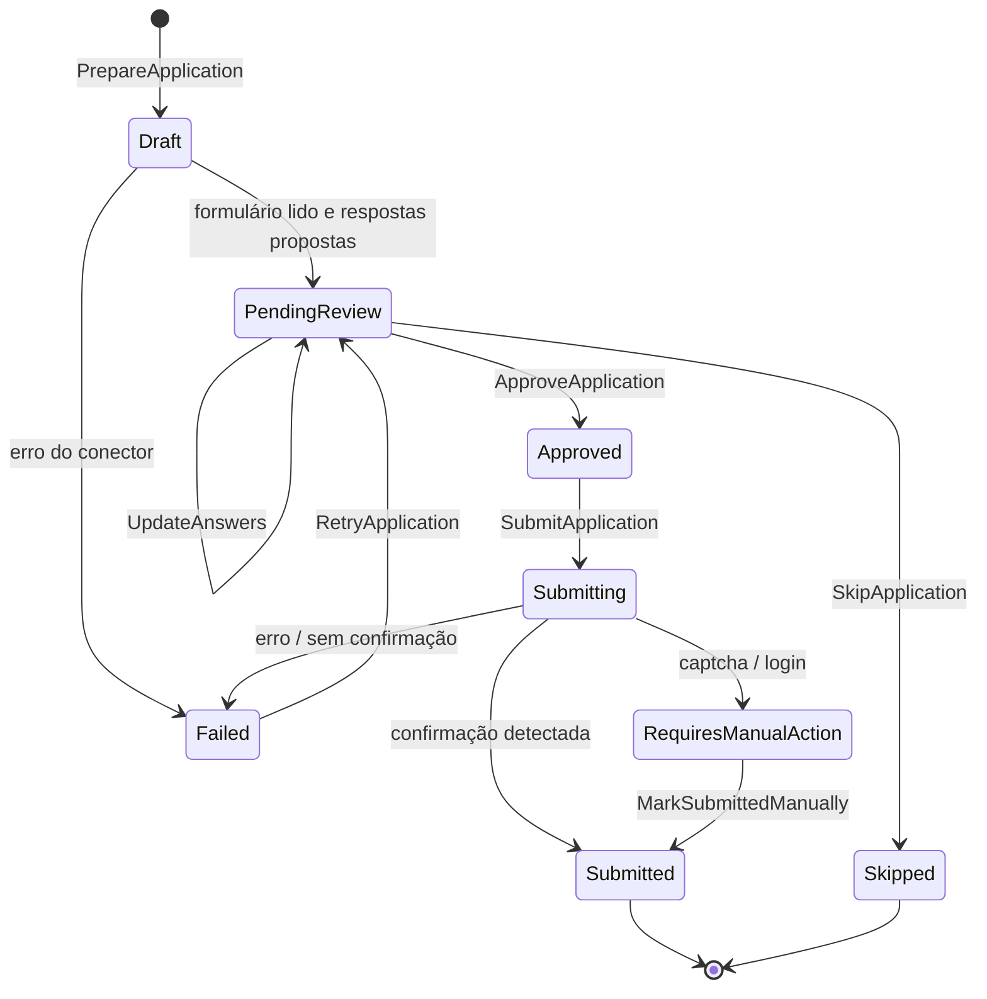

# 02 — Arquitetura

## 1. Decisão de arquitetura

Respostas que orientaram a escolha da arquitetura:

| Categoria | Resposta | Sinal |
|---|---|---|
| Complexidade de domínio | ~10 entidades, uma máquina de estados (candidatura), regras de pontuação | Baixa/média |
| Time | 1 desenvolvedor | Baixo |
| Ciclo de vida | Uso pessoal contínuo, evolução incremental | Médio |
| Compliance | Dados pessoais próprios (LGPD), sem auditoria regulatória | Baixo |
| Base existente | Greenfield | — |
| Integrações | **N plataformas externas**, instáveis, com contratos diferentes | **Alto** |

Resultado:

- **Núcleo em Vertical Slice Architecture** (ADR-001): o domínio é simples; a complexidade está nas integrações, não nas regras de negócio. VSA entrega rápido e mantém cada operação num arquivo.
- **Conectores em Ports & Adapters** (ADR-007): o único ponto realmente variável do sistema (as plataformas) fica atrás de contratos estáveis, em projetos separados. É uma aplicação localizada do princípio de Clean Architecture onde ele paga o custo, sem impor 4 camadas ao resto.

> Regra de ouro: **adicionar uma plataforma nova = adicionar um projeto + uma linha de registro + uma seção de configuração.** Se isso exigir mudar `Features/`, `Workers/` ou o modelo de dados, o contrato está errado e deve ser revisto antes.

## 2. Visão de contexto

## 3. Projetos e dependências

| Projeto | SDK | Responsabilidade | Pode depender de |
|---|---|---|---|
| `JobHunter.Api` | `Microsoft.NET.Sdk.Web` | Host, endpoints, handlers (VSA), workers, EF Core, composição de conectores, pontuação, deduplicação, preenchimento genérico de formulário | `Connectors.Abstractions`; conectores **somente** em `Common/Connectors/ConnectorRegistration.cs` |
| `JobHunter.Connectors.Abstractions` | `Microsoft.NET.Sdk` | Interfaces de capacidade, DTOs, `ConnectorDescriptor`, `ConnectorError`, `Result` dos conectores | Nada além do BCL e `Microsoft.Extensions.*.Abstractions` |
| `JobHunter.Connectors.Browser` | `Microsoft.NET.Sdk` | `BrowserProvider`, contexto por operação, captura de evidência, helpers para mapear formulários HTML em `ApplicationForm` | `Abstractions`, `Microsoft.Playwright`, `AngleSharp` |
| `JobHunter.Connectors.InHire` | `Microsoft.NET.Sdk` | Adapter InHire: tenant source, detalhes, canal de candidatura | `Abstractions`, `Browser` |
| `JobHunter.Connectors.Testing` | `Microsoft.NET.Sdk` (em `tests/`) | Testes de contrato abstratos, `FakeConnector`, builders | `Abstractions`, `xunit.v3` |

Por que `Connectors.Browser` é um projeto separado: conectores baseados em API (Greenhouse, Lever) não devem carregar o Playwright. Conectores baseados em navegador reaproveitam a mesma infraestrutura (um único Chromium por processo, mesma política de evidências).

## 4. Modelo de conectores

### 4.1 Capacidades em vez de interface única

As plataformas diferem muito. Uma interface única forçaria `NotSupportedException` em metade dos métodos. Por isso cada capacidade é uma interface pequena (ISP), e o conector declara as que implementa no descritor.

| Capacidade | Interface | Exemplo de uso |
|---|---|---|
| Listar vagas de um tenant | `ITenantJobSource` | InHire, Gupy, Greenhouse, Lever (uma página/endpoint por empresa) |
| Buscar vagas por critérios | `ISearchJobSource` | Plataformas centrais (LinkedIn, Indeed) quando permitido |
| Ingerir de feed/caixa de entrada | `IFeedJobSource` | Alertas por e-mail, RSS |
| Detalhar vaga | `IJobDetailsProvider` | Descrição completa, requisitos, URL de candidatura |
| Candidatar | `IApplicationChannel` | Ler formulário, enviar, abrir modo assistido |
| Descobrir tenants | `ITenantDiscovery` | Encontrar novas empresas que usam a plataforma |

Contratos completos em `docs/07-conectores.md`.

### 4.2 Fonte ≠ canal de candidatura

- `PostingSource` registra **de onde** a vaga veio (pode haver várias).
- `JobPosting.ApplyUrl` e `ApplyChannelKey` dizem **por onde** se candidatar.
- O `ApplyChannelResolver` pergunta a cada `IApplicationChannel` registrado se `CanHandle(applyUrl)`. O primeiro que aceitar vira o canal. Nenhum aceitou → `ManualApplyOnly`.

Isso permite, por exemplo, capturar vagas do LinkedIn por alertas de e-mail (meio permitido) e enviar a candidatura pelo InHire, quando a vaga do LinkedIn aponta para uma página InHire.

### 4.3 Deduplicação entre plataformas

Ordem de tentativas no handler `UpsertPosting`:

1. Mesma `(connector_key, external_id)` → mesma `PostingSource` → atualiza.
2. Mesma `ApplyUrl` normalizada (minúsculas, sem query de rastreamento `utm_*`, sem barra final) → anexa nova `PostingSource` à `JobPosting` existente.
3. Mesmo `Fingerprint` = hash de `(company normalizada, título normalizado, cidade normalizada)` dentro de uma janela de 30 dias → anexa e marca `DedupConfidence = Probable`.
4. Nenhum → cria nova `JobPosting`.

Normalizações (remover acentos, caixa, sufixos de empresa como "Ltda", "S.A.") ficam em `Common/Text/Normalizer.cs`, cobertas por testes.

### 4.4 Formulário genérico

Cada canal traduz o formulário da plataforma para `ApplicationForm`, uma lista de `FormField` com um **significado semântico** (`FieldSemantic`): `FullName`, `Email`, `Phone`, `LinkedInUrl`, `PortfolioUrl`, `Resume`, `CoverLetter`, `SalaryExpectation`, `City`, `Custom`...

O núcleo preenche os campos com `FieldSemantic` conhecido a partir do `CandidateProfile` e trata `Custom` como **pergunta de triagem**: busca no banco de `AnswerTemplate`, opcionalmente pede sugestão ao LLM, e leva para revisão. Nenhuma lógica de preenchimento existe dentro dos conectores; eles só **descrevem** o formulário e **executam** o envio com os valores finais.

### 4.5 Registro e resolução

- Cada projeto de conector expõe `services.Add<Plataforma>Connector(configuration)`.
- Internamente registra as implementações como **keyed services** com a chave do conector (`"inhire"`), além do `IJobConnector` em uma coleção.
- `IConnectorRegistry` (no núcleo) responde:
  - `GetEnabled()` → descritores dos conectores habilitados;
  - `TryGet<TCapability>(key, out capability)` → resolve a capacidade se declarada e registrada;
  - `ResolveChannelFor(Uri applyUrl)`.
- Habilitar/desabilitar: `Connectors:<Key>:Enabled` no `appsettings`. Desabilitado = não registrado.
- Composição estática (referência de projeto), **sem** carregamento dinâmico de DLL (ADR-007 explica por quê).

### 4.6 Isolamento de falhas

| Mecanismo | Escopo | Onde |
|---|---|---|
| Pipeline Polly (timeout + retry + circuit breaker) | Por conector (`connector:{key}`) | Núcleo, `ConnectorInvoker` |
| Rate limiter + delay de cortesia com jitter | Por conector | Núcleo, `ConnectorRateLimiter` (`PartitionedRateLimiter`) |
| Limite diário de envios | Por conector + global | Handler `SubmitApplication` |
| Concorrência | Por conector + global de páginas de navegador | `ConnectorRateLimiter` + `BrowserProvider` |
| Evidência em falha | Por operação | `Connectors.Browser` (`ArtifactWriter`) |
| Saúde | Por conector | Health check `connectors` lista estado de cada um (circuito aberto, último erro) |

Todas as chamadas do núcleo para conectores passam pelo `ConnectorInvoker`, que aplica rate limit, resiliência, métricas e tradução de exceções inesperadas em `ConnectorError.Transient`. Assim, nenhum conector precisa reimplementar essas preocupações, e um conector instável nunca derruba os outros.

## 5. Núcleo (JobHunter.Api) — áreas de feature

| Área | Responsabilidade | Slices principais |
|---|---|---|
| `Connectors` | Listar conectores, capacidades e saúde | `ListConnectors` |
| `Sources` | Fontes monitoradas (tenants e buscas salvas) | `AddSource`, `ImportSources`, `UpdateSource`, `ListSources`, `TriggerSourceScan` |
| `Scanning` | Executar varreduras e registrar `ScanRun` | `ScanDueSources`, `ScanSource`, `ListScanRuns` |
| `Postings` | Upsert, deduplicação, consulta, descarte | `UpsertPosting`, `ListPostings`, `GetPosting`, `DiscardPosting`, `RefreshPostingDetails` |
| `Matching` | Perfis de busca e pontuação | `ScorePendingPostings`, `CRUD SearchProfile` |
| `Applications` | Preparar, revisar, aprovar, enviar | `PrepareApplication`, `ListApplications`, `GetApplication`, `UpdateAnswers`, `ApproveApplication`, `SkipApplication`, `SubmitApplication`, `OpenAssisted` |
| `Answers` | Banco de respostas reutilizáveis | `CRUD AnswerTemplate`, `SuggestAnswer` |
| `Profile` | Perfil do candidato e currículo | `GetProfile`, `UpdateProfile`, `UploadResume` |
| `Discovery` | Descobrir tenants via `ITenantDiscovery` | `DiscoverTenants` |

Serviços de núcleo compartilhados (em `Common/`): `ConnectorRegistry`, `ConnectorInvoker`, `ConnectorRateLimiter`, `ApplyChannelResolver`, `FormAnswerer`, `MatchScorer`, `Normalizer`, `ArtifactRetention`.

## 6. Fluxos em tempo de execução

### 6.1 Varredura

### 6.2 Preparação, revisão e envio

## 7. Cenários de extensão (validação do desenho)

| Plataforma futura | Capacidades | Tecnologia | Muda o núcleo? |
|---|---|---|---|
| **Greenhouse / Lever** | `ITenantJobSource`, `IJobDetailsProvider` (APIs públicas de job board); canal pode ser browser | `IHttpClientFactory` | Não |
| **Gupy** | `ITenantJobSource`, `IJobDetailsProvider`, `IApplicationChannel` (exige conta) | Playwright + sessão por conector | Não |
| **LinkedIn** | `IFeedJobSource` (alertas por e-mail) e importação manual de URL; **sem** busca/candidatura automatizada | Leitor de e-mail (IMAP/Graph) + parser | Não. Vagas com link externo são roteadas ao canal correspondente |
| **Planilha / lista manual** | `IFeedJobSource` | CSV | Não |

Sobre o LinkedIn: o Contrato do Usuário do LinkedIn proíbe o uso de bots e scraping, e contas que automatizam navegação ou candidaturas costumam ser restringidas. Por isso o desenho prevê captura por meios permitidos (alertas que você já recebe por e-mail ou URLs que você cola), e o envio acontece no canal de destino quando a vaga aponta para outro ATS. A decisão final fica registrada na matriz de conectores (`docs/07-conectores.md`) e na spec do conector.

## 8. Decisões relacionadas

| ADR | Decisão |
|---|---|
| ADR-001 | VSA no núcleo |
| ADR-002 | PostgreSQL + EF Core sem repository, `snake_case` |
| ADR-003 | Workers + banco como fila (sem message broker) |
| ADR-004 | Revisão humana obrigatória antes do envio |
| ADR-005 | Playwright para conectores que precisam de navegador; API/HTTP quando disponível |
| ADR-006 | API somente em localhost + API key |
| ADR-007 | Conectores plugáveis por capacidade, composição estática com keyed services |
| ADR-008 | Separação entre fonte de captura e canal de candidatura; deduplicação canônica |

## 9. Evolução prevista

| Gatilho | Evolução |
|---|---|
| 3+ conectores com regras próprias de sessão/conta | Extrair `ConnectorSession` para um slice próprio com renovação agendada |
| Interface pelo Scalar ficar limitante | UI dedicada (Blazor ou SPA) consumindo a mesma API |
| Rodar fora da máquina local | Container + autenticação real (OIDC), ver `docs/11-infra-local.md` |
| Volume alto de varreduras | Fila em PostgreSQL com `FOR UPDATE SKIP LOCKED` ou Wolverine |
