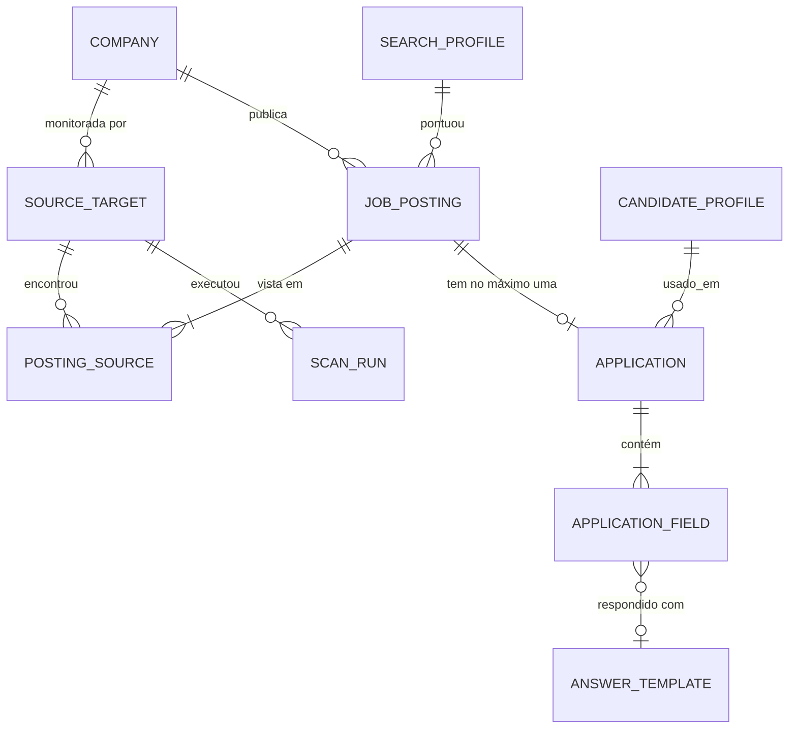
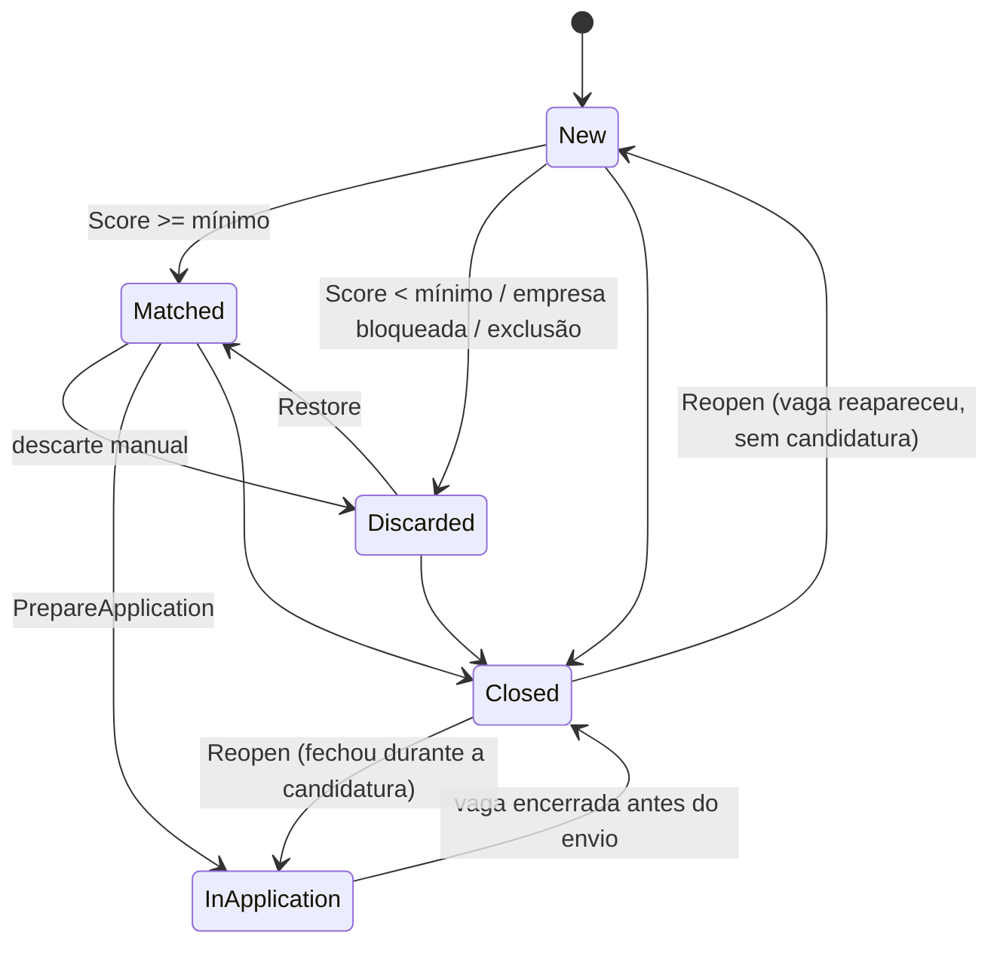

# 03 — Modelo de dados

PostgreSQL via EF Core + Npgsql. Convenções (ADR-002):

- Tabelas e colunas em `snake_case` (`EFCore.NamingConventions` → `UseSnakeCaseNamingConvention()`).
- Chaves `uuid` geradas na aplicação com `Guid.CreateVersion7(clock.GetUtcNow())` (ordenáveis, bons para índice).
- Datas em `timestamptz` como `DateTimeOffset` UTC, sempre vindas de `TimeProvider`.
- Enums gravados como `text` (`HasConversion<string>()`), legíveis no banco e seguros para reordenação.
- Listas simples como `text[]`; estruturas flexíveis como `jsonb` (`OwnsMany(...).ToJson()` ou propriedades `JsonDocument`/records mapeados).
- Concorrência otimista com `xmin` (`uint Version` + `IsRowVersion()`).
- Toda chave de conector é `text` validada pelo registro (`[a-z0-9-]+`). **Não há FK para conectores**: eles vivem no código.

## 1. Diagrama



## 2. Entidades

### 2.1 `Company` — empresa real, independente de plataforma

| Coluna | Tipo | Regras |
|---|---|---|
| `id` | uuid PK | |
| `name` | text | obrigatório |
| `normalized_name` | text | único; sem acento, minúsculo, sem sufixos societários |
| `website` | text null | |
| `notes` | text null | |
| `is_blocked` | bool | se `true`, vagas desta empresa são descartadas na pontuação (`POST /api/companies/{id}/block`; as vagas abertas voltam para `New` e são pontuadas de novo) |
| `created_at` | timestamptz | |

Criada automaticamente no upsert de vagas a partir de `SourcedPosting.CompanyName` (ou do nome do tenant) quando não existir.

### 2.2 `SourceTarget` — o que é monitorado

| Coluna | Tipo | Regras |
|---|---|---|
| `id` | uuid PK | |
| `connector_key` | text | obrigatório |
| `kind` | text | `Tenant` \| `Search` \| `Feed` |
| `tenant_ref` | text null | obrigatório se `Tenant` (ex.: `eyxo`) |
| `search_criteria` | jsonb null | obrigatório se `Search` (`SearchCriteria`) |
| `checkpoint` | text null | cursor/checkpoint opaco do conector (`Search`/`Feed`) |
| `company_id` | uuid FK null | empresa associada (tenants) |
| `display_name` | text | |
| `is_active` | bool | |
| `scan_interval` | interval null | sobrescreve o do conector |
| `last_scan_at` | timestamptz null | |
| `next_scan_at` | timestamptz | índice; workers buscam `next_scan_at <= now()` |
| `consecutive_failures` | int | após `Scanning:DeactivateAfterFailures` → `is_active = false` |
| `last_error_code` | text null | |
| `version` | xid | concorrência |

Índices: único `(connector_key, tenant_ref)` quando `kind = 'Tenant'` (índice parcial); `(is_active, next_scan_at)`.

Métodos: `RecordSuccess(now, nextInterval)`, `RecordFailure(now, errorCode, nextInterval, threshold)` (retorna `true` quando desativa), `Deactivate()`, `Reactivate(now)`, `UpdateCheckpoint(value)`.

### 2.3 `JobPosting` — vaga canônica

| Coluna | Tipo | Regras |
|---|---|---|
| `id` | uuid PK | |
| `company_id` | uuid FK | |
| `title` | text | |
| `normalized_title` | text | para dedup |
| `location` | text null | |
| `normalized_city` | text null | |
| `work_model` | text null | `OnSite` \| `Hybrid` \| `Remote` |
| `seniority` | text null | texto livre da plataforma |
| `employment_type` | text null | CLT, PJ, estágio... |
| `description_text` | text null | |
| `description_html` | text null | |
| `requirements` | text[] | |
| `apply_url` | text null | |
| `normalized_apply_url` | text null | índice único parcial (não nulo) |
| `apply_channel_key` | text null | conector que envia; `null` = `ManualApplyOnly` |
| `fingerprint` | text | hash (empresa, título, cidade) normalizados |
| `dedup_confidence` | text | `Exact` \| `Probable` |
| `status` | text | ver máquina de estados |
| `match_score` | int null | 0–100 |
| `match_reasons` | jsonb | lista de `{rule, weight, matched}` |
| `scored_with_profile_id` | uuid null | |
| `published_at` | timestamptz null | |
| `first_seen_at` | timestamptz | |
| `last_seen_at` | timestamptz | |
| `closed_at` | timestamptz null | |
| `discard_reason` | text null | `LowScore`, `CompanyBlocked`, `ExcludedKeyword:<termo>`, `MissingRequired`, `LocationMismatch` ou o motivo informado no descarte manual |
| `is_manually_discarded` | bool | descarte manual; o recálculo de notas não mexe nessas vagas |
| `status_before_close` | text null | permite que `Reopen` devolva a vaga ao estado certo |
| `version` | xid | |

Índices: `(status)`, `(fingerprint, first_seen_at)`, `(company_id)`, `(match_score desc) where status = 'Matched'`.

Máquina de estados:



Métodos: `ApplyMatch(result, profileId, minScore)`, `RequestRescore()`, `Discard(reason)`, `Restore()`, `Close(now)`, `Reopen()`, `Refresh(snapshot, company, now)` (atualiza dados e `last_seen_at`), `AssignChannel(key?)`, `UpdateFrom(details, now)`, `MarkProbableDuplicate()`. `StartApplication()` entra com as candidaturas.

Uma vaga `Closed` com candidatura `Submitted` mantém a candidatura como está.

### 2.4 `PostingSource` — onde a vaga foi vista

| Coluna | Tipo | Regras |
|---|---|---|
| `id` | uuid PK | |
| `job_posting_id` | uuid FK | cascade delete |
| `source_target_id` | uuid FK null | `null` para importação manual |
| `connector_key` | text | |
| `external_id` | text | |
| `source_url` | text | |
| `extra` | jsonb | `SourcedPosting.Extra` |
| `first_seen_at` | timestamptz | |
| `last_seen_at` | timestamptz | |
| `missed_scans` | int | zerado quando vista; ao atingir `ClosedAfterMissedScans` e todas as fontes da vaga estiverem ausentes → `JobPosting.Close()` |

Índice único: `(connector_key, external_id)`.

### 2.5 `SearchProfile` — critérios e pesos

| Coluna | Tipo | Regras |
|---|---|---|
| `id` | uuid PK | |
| `name` | text | |
| `is_active` | bool | o scorer usa os perfis ativos; a vaga fica com a **maior** nota |
| `required_keywords` | text[] | ao menos uma deve aparecer em título ou descrição |
| `preferred_keywords` | text[] | somam pontos |
| `excluded_keywords` | text[] | qualquer ocorrência no **título** descarta |
| `excluded_description_keywords` | text[] | ocorrência na descrição penaliza |
| `locations` | text[] | cidades aceitas (normalizadas) |
| `work_models` | text[] | |
| `seniorities` | text[] | termos aceitos (ex.: "pleno", "sênior") |
| `min_score` | int | padrão 60 |
| `weights` | jsonb | pesos por regra (título, descrição, local, modelo, senioridade) |

### 2.6 `CandidateProfile` — seus dados (linha única)

| Coluna | Tipo | Regras |
|---|---|---|
| `id` | uuid PK | uma única linha |
| `full_name` | text | |
| `email` | text | |
| `phone` | text | |
| `city`, `state`, `country` | text | |
| `linkedin_url`, `github_url`, `portfolio_url` | text null | |
| `resume_file_path` | text | caminho local fora do repositório |
| `resume_text` | text null | extraído do PDF, usado para sugestões |
| `professional_summary` | text | usado em sugestões de LLM |
| `salary_expectation` | text null | |
| `default_values` | jsonb | valores por `FieldSemantic` adicionais |
| `updated_at` | timestamptz | |

Dados pessoais: nunca logados (destructuring do Serilog mascara o tipo inteiro). Alternativa mais restrita, adiada por enquanto: manter contato em `user-secrets` e não no banco.

### 2.7 `AnswerTemplate` — respostas reutilizáveis

| Coluna | Tipo | Regras |
|---|---|---|
| `id` | uuid PK | |
| `question_pattern` | text | texto normalizado de referência |
| `keywords` | text[] | termos que disparam a sugestão |
| `field_kind` | text null | restringe a um tipo de campo |
| `answer_text` | text null | |
| `answer_options` | text[] | rótulos preferidos para escolha única/múltipla |
| `times_used` | int | |
| `last_used_at` | timestamptz null | |
| `is_active` | bool | |

Matching (no `FormAnswerer`): similaridade entre a pergunta normalizada e `question_pattern` (trigramas com `pg_trgm` **ou** em memória) + presença de `keywords`. Abaixo do limiar → sem sugestão.

### 2.8 `Application` — candidatura

| Coluna | Tipo | Regras |
|---|---|---|
| `id` | uuid PK | |
| `job_posting_id` | uuid FK | **único** |
| `channel_key` | text | copiado de `JobPosting.apply_channel_key` no momento da preparação |
| `apply_url` | text | |
| `form_hash` | text | do `ApplicationForm` inspecionado |
| `status` | text | ver máquina de estados em `docs/02-arquitetura.md` §6.2 |
| `mode` | text | `ReviewThenSubmit` \| `Assisted` |
| `prepared_at` | timestamptz | |
| `approved_at` | timestamptz null | |
| `submitted_at` | timestamptz null | |
| `attempt_count` | int | |
| `last_error_kind` | text null | `ConnectorErrorKind` |
| `last_error_message` | text null | |
| `evidence_paths` | text[] | |
| `confirmation_text` | text null | |
| `external_application_id` | text null | |
| `notes` | text null | suas anotações |
| `version` | xid | |

Métodos (todos retornam `Result`): `MarkPendingReview(form)`, `UpdateAnswer(fieldKey, value)`, `Approve(now)` (falha se algum campo obrigatório sem resposta final ou consentimento não revisado), `Skip(reason)`, `StartSubmitting(now)`, `MarkSubmitted(receipt)`, `MarkFailed(error)`, `RequireManualAction(error)`, `MarkSubmittedManually(now)`, `ResetForReview(newForm)` (após `FormChanged`), `Retry()`.

### 2.9 `ApplicationField` — campo do formulário com resposta

| Coluna | Tipo | Regras |
|---|---|---|
| `id` | uuid PK | |
| `application_id` | uuid FK | cascade |
| `key` | text | `FormField.Key`; único por aplicação |
| `label` | text | |
| `kind` | text | `FieldKind` |
| `semantic` | text | `FieldSemantic` |
| `required` | bool | |
| `options` | jsonb | `FieldOption[]` |
| `max_length` | int null | |
| `proposed_value` | jsonb null | `FieldValue` proposto |
| `proposal_source` | text | `Profile` \| `Template` \| `Llm` \| `None` |
| `answer_template_id` | uuid null | |
| `final_value` | jsonb null | o que será enviado |
| `reviewed` | bool | marcado quando você edita ou confirma |
| `order` | int | |

### 2.10 `ScanRun` — execução de varredura

| Coluna | Tipo | Regras |
|---|---|---|
| `id` | uuid PK | |
| `source_target_id` | uuid FK | |
| `connector_key` | text | |
| `started_at`, `finished_at` | timestamptz | |
| `status` | text | `Running` \| `Succeeded` \| `PartiallySucceeded` \| `Failed` (`Running` enquanto a varredura disparada pela API aguarda ou executa) |
| `found` | int | itens retornados |
| `created` | int | vagas novas |
| `updated` | int | |
| `deduplicated` | int | anexadas a vaga existente |
| `closed` | int | |
| `error_kind`, `error_message`, `evidence_path` | text null | |

Retenção: `Scanning:RunRetentionDays` (padrão 90), limpo por `MaintenanceWorker`.

### 2.11 `ConnectorState` — estado operacional persistido

| Coluna | Tipo | Regras |
|---|---|---|
| `connector_key` | text PK | |
| `paused_until` | timestamptz null | captcha/layout/rate limit |
| `pause_reason` | text null | |
| `last_success_at`, `last_failure_at` | timestamptz null | |
| `submissions_today` | int | zerado pelo `MaintenanceWorker` na virada do dia (fuso `App:TimeZone`) |
| `submissions_date` | date | |

Permite que pausas sobrevivam a reinícios e alimenta o health check.

## 3. Configuração EF Core

- Um `IEntityTypeConfiguration<T>` por entidade em `Common/Persistence/Configurations/`.
- `AppDbContext` em `Common/Persistence/AppDbContext.cs`, com `DbSet` para cada entidade.
- `ApplyConfigurationsFromAssembly`.
- Interceptor `TimestampsInterceptor` preenche `created_at`/`updated_at` via `TimeProvider`.
- Consultas de leitura usam `AsNoTracking()` e projeção para `Response` do slice.
- Atualizações em massa (`missed_scans`, limpeza) com `ExecuteUpdateAsync`/`ExecuteDeleteAsync`.
- Extensão `pg_trgm` habilitada por migration (`CREATE EXTENSION IF NOT EXISTS pg_trgm`) se o matching de templates for feito no banco.

## 4. Migrations

```bash
dotnet ef migrations add InitialSchema --project src/JobHunter.Api --output-dir Common/Persistence/Migrations
dotnet ef database update --project src/JobHunter.Api
```

- Revisar toda migration gerada antes de aplicar.
- Desenvolvimento: aplicar com `dotnet ef database update`. Sem `Database.Migrate()` automático no startup.
- Nomes de migration descrevem o schema (`AddApplicationFields`), nunca specs ou fases.
